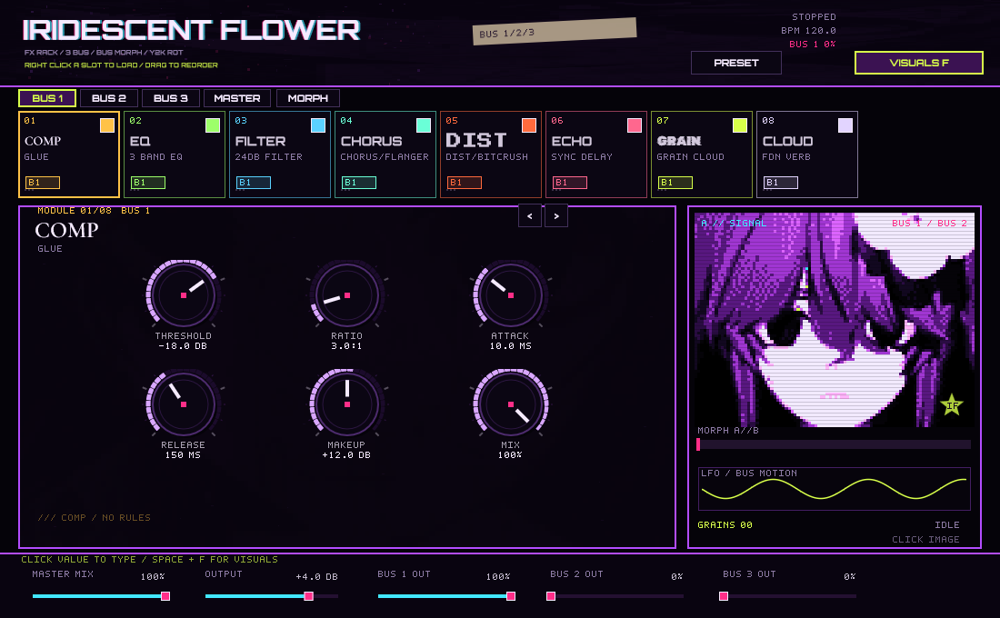
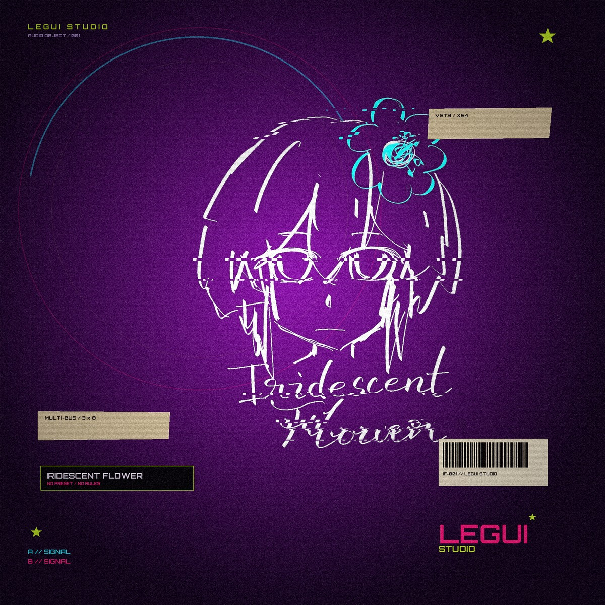
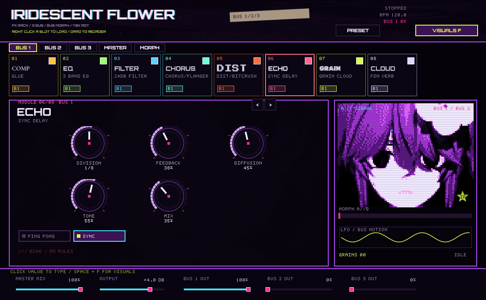
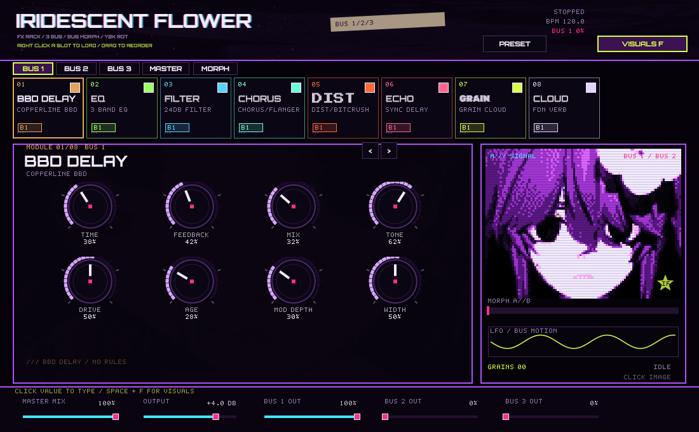

# Iridescent Flower

**Windows x64 VST3 · JUCE 8.0.13 · AGPL-3.0**

Iridescent Flower 是一款 Windows x64 VST3 多总线模块化效果器，可用于支持 VST3 的 DAW 与宿主。界面采用像素化视觉语言，信号结构围绕三条并行 Bus、一条 Master 链和固定的 Morph 输出级展开。





## 概述

Iridescent Flower 将效果器机架、并行 Bus 路由、总线处理与 Morph 交叉融合整合在同一个插件中。

- 3 条并行 Bus，每条 Bus 提供 8 个效果槽。
- 1 条 Master 链，提供 8 个效果槽，在 Bus 1/2/3 之后统一处理。
- 1 个固定 Morph 输出级，用于 Bus 1、Bus 2 或 Sidechain 之间的交叉。
- 32 个槽位拥有相互独立的模块参数。
- 支持从外部文件夹加载自定义 DLL 模块。
- 支持内置头像与用户自定义头像。

## 主要特性

### 多总线结构

顶部导航包含 `BUS 1`、`BUS 2`、`BUS 3`、`MASTER` 与 `MORPH` 五个页面。

| 页面 | 槽位数 | 作用 |
| --- | ---: | --- |
| Bus 1 | 8 | 并行处理链 A |
| Bus 2 | 8 | 并行处理链 B |
| Bus 3 | 8 | 并行处理链 C |
| Master | 8 | 总线路由后的最终处理 |
| Morph | — | Bus 1 / Bus 2 或 Sidechain 的交叉级 |

默认输出电平为：

```
BUS 1 OUT  100%
BUS 2 OUT    0%
BUS 3 OUT    0%
```

`BUS 2 OUT` 控制 Bus 2 的直接并行发送；Morph 的 B 输入取自 Bus 2 链本身，因此 Morph 可在 Bus 2 直接输出为 0% 时仍然完成 A/B 融合。

信号路径：

```
Bus 1 chain ─────────────── Morph A ─┐
Bus 2 chain ── Morph B ──┐            │
Bus 2 chain ── BUS 2 OUT ─┼───────────┼─ MASTER ─ OUTPUT
Bus 3 chain ── BUS 3 OUT ─┘           │
```

### 独立槽位参数

每个 Bus 与 Master 的 8 个槽均拥有独立的参数状态和独立的模块实例。

- Bus 1 的 Compressor 不会影响 Bus 2 或 Master 的 Compressor。
- 同一 Bus 中放置两个相同模块时，两个模块的参数互不影响。
- 模块换序时，模块实例及其参数状态一同移动。
- 删除模块后，后续模块与参数立即左移，空位保留在链尾。
- 预设保存全部 32 个槽位的参数。
- 宿主自动化作用于当前选中的槽位；切换槽位后自动化目标同步切换。

### 工厂预设

插件内置五个工厂预设，随二进制编译，不依赖外部文件：

| 预设 | 用途 |
| --- | --- |
| `PAD_EasyStrings` | 默认启动预设，宽缓弦乐/Pad 方向 |
| `PLUCK_EasyGrains` | 粒子化拨弦 |
| `BASS_ALittleBitWide` | 立体声贝斯 |
| `KEY_SpaceBits` | 太空感键盘 |
| `DRUM_Stereo` | 立体声鼓组处理 |

新建插件实例时默认加载 `PAD_EasyStrings`。宿主恢复工程状态时会覆盖启动预设。

打开顶部 `PRESET` 菜单 → `FACTORY PRESETS` 可切换内置预设；`SAVE PRESET` / `LOAD PRESET` 仍用于保存和读取用户 `.iflower` 文件。

### Morph 与 LFO

Morph 页面集成 Bus 1 / Bus 2 交叉控制与 LFO 调制，不设置独立 LFO 槽。

可调参数：

- `MORPH`
- `B TRIM`
- `CURVE`
- `B WIDTH`
- `LFO RATE`
- `LFO DEPTH`
- `LFO PHASE`
- `LFO SHAPE`

`B SOURCE` 支持：

- `SIDECHAIN`
- `BUS 2`
- `INTERNAL`

LFO 仅调制 Morph 量，默认深度为 0。

### Sync 旋钮模式

Echo 与 Grain 采用单一旋钮的双模式设计。

- **Echo**：启用 `SYNC` 后，`TIME` 旋钮切换为 `DIVISION`，可选 `1/32` 至 `1 BAR`。
- **Grain**：启用 `SYNC` 后，`DENSITY` 旋钮切换为 `DIVISION`。
- Division 使用独立的步进参数保存，切换页面或模块后保持原值。



### 模块

| 模块 | 功能 |
| --- | --- |
| Compressor | Threshold、Ratio、Attack、Release、Makeup、Mix |
| EQ | 三段 Low / Mid / High、Mid Frequency、Output |
| Filter | 24 dB 状态变量滤波器，Low Pass / High Pass / Band Pass / Notch |
| Chorus / Flanger | 双模式调制、反馈、Mix、Rate、Depth |
| Distortion / Bitcrush | Drive、Tone、Bits、Downsample、Mix、Mode |
| Hyper / Dimension | 立体声扩展与维度处理 |
| Echo | Time、Feedback、Diffusion、Tone、Mix、Ping Pong、Sync |
| Grain | Size、Density、Pitch、Spray、Feedback、Mix、Reverse、Width、Buffer、Offset、Rate、Sync、Snap |
| Cloud | FDN 混响、Size、Decay、Damping、Mod、Pre-Delay、Low Cut、Width、Mix |
| Morph | 固定输出级，不属于可替换槽 |
| Custom 1–8 | 用户 DLL 模块，每个模块 8 个参数 |

### Grain：Rate 与 Pitch

`RATE` 与 `PITCH` 为两个独立维度：

- `RATE` 控制粒子触发速率，影响粒子密度与节奏，不改变音高。
- `DENSITY` 为基础粒子密度，与 `RATE` 共同决定实际触发间隔。
- `PITCH` 仅控制移调，范围 `-24 st` 至 `+24 st`，步进 `0.01 st`，显示两位小数。

粒子读取速度仅由 Pitch 与反向状态决定，界面显示的移调值与实际渲染音高一致。

### 可视化与头像

右侧面板根据当前模块显示不同内容：

- **EQ**：只读频率响应曲线。
- **Filter**：只读频率响应曲线。
- **其他模块**：头像面板。

头像区域支持：

- 4 张内置像素头像自动轮换。
- 点击头像区域打开头像菜单。
- 从 `PNG / JPG / JPEG / WebP` 文件加载自定义头像。
- 自定义头像自动复制到 `Documents/Iridescent Flower/Avatars`。
- 在菜单中选择内置头像或用户头像。
- 当前头像记录在插件状态中，重新打开工程后保持。

自定义头像目录：

```
Documents\Iridescent Flower\Avatars\
```

头像绘制严格裁剪在右侧面板范围内。

### 参数输入

- 单击旋钮下方的数值打开数值输入框。
- 双击旋钮同样打开输入框。
- 输入框接受当前参数单位，例如 Hz、ms、dB、st、%。

### 界面与字体

- 主字体：Orbitron。
- Compressor：Cormorant Garamond。
- Distortion：Press Start 2P。
- Grain：Rubik Glitch。
- 其余模块：Orbitron。

字体均为 SIL Open Font License 字体，位于 `Assets/Fonts/`，随 BinaryData 编译。

## 自定义模块

自定义模块为 Windows x64 DLL，放置于：

```
Documents\Iridescent Flower\Custom Modules\
```

插件启动时扫描该目录，最多加载 8 个 DLL。右键空槽选择 `LOAD FX` 即可将 DLL 作为模块装载；已有模块的槽位显示 `REPLACE FX`。

每个自定义模块提供 8 个参数，参数值以 `0…1` 归一化传入 DLL。

ABI 定义于 [`Source/CustomModuleApi.h`](Source/CustomModuleApi.h)，导出函数：

```cpp
if_get_module_info()
if_create(sampleRate, maxBlockSize)
if_destroy(instance)
if_process(instance, left, right, numSamples, params[8], 8, bpm)
```

完整说明与最小示例：

- [Custom Modules README](CustomModules/README.md)
- [CustomModuleApi.h](Source/CustomModuleApi.h)

### 示例模块：BBD Delay

`CustomModules/Bbd/` 包含将 BBD 延迟引擎封装为自定义模块的示例，构建目标为 `IridescentBbdCustom`。

参数：

```
TIME / FEEDBACK / MIX / TONE / DRIVE / AGE / MOD DEPTH / WIDTH
```



## 安装

### 推荐：Windows 安装程序

预编译安装程序发布在：

```
https://github.com/iwillenterausername/iridescent-flower/releases/latest
```

下载：

```
IridescentFlower-1.1.0-Setup.exe
```

安装步骤：

1. 双击 `IridescentFlower-1.1.0-Setup.exe`。
2. 在 Windows UAC 提示中选择“是”。
3. 确认 VST3 安装目录（默认 `C:\Program Files\Common Files\VST3`）。
4. 勾选是否安装示例 BBD Delay 自定义模块。
5. 点击 `Install`。
6. 在宿主中重新扫描 VST3 插件，然后加载 `LeGui Studio → Iridescent Flower`。

安装程序包含图形界面、目标目录选择、可选自定义模块和 Windows“应用和功能”卸载入口，不需要使用命令行。

> 安装程序、VST3 与 BbdDelay.dll 使用 **LeGui Studio** 自签名代码签名证书。Windows 默认仍可能显示未知发布者；如需本地信任，可安装 Release 中的 `LeGuiStudio-CodeSigning.cer`。面向公众分发建议使用公共 CA 颁发的代码签名证书。

### 便携 ZIP / 高级安装

如需免安装版本或手动部署：

```
Iridescent-Flower-1.1.0-VST3-win64.zip
```

压缩包结构：

```
Iridescent Flower.vst3/          插件本体（文件夹）
Custom Modules/BbdDelay.dll     示例自定义模块
Custom Modules/README.md        自定义模块说明
Install-IridescentFlower.ps1    安装脚本
INSTALL.txt                     安装说明
```

> `.vst3` 是文件夹，不是单个文件。必须完整复制整个 `Iridescent Flower.vst3` 文件夹，不能只复制其中的二进制文件。

#### 使用 ZIP 内脚本（可选）

1. 将 ZIP 完整解压到任意目录。
2. 以管理员身份打开 PowerShell，进入解压目录。
3. 执行：

```powershell
powershell -ExecutionPolicy Bypass -File .\Install-IridescentFlower.ps1
```

默认安装至：

```
C:\Program Files\Common Files\VST3\Iridescent Flower.vst3
```

并将示例自定义模块复制到：

```
Documents\Iridescent Flower\Custom Modules\
```

写入 `Program Files` 需要管理员权限。

安装到自定义 VST3 目录：

```powershell
powershell -ExecutionPolicy Bypass -File .\Install-IridescentFlower.ps1 -VST3Folder "D:\VST"
```

#### 手动安装

1. 将整个 `Iridescent Flower.vst3` 文件夹复制到：
   ```
   C:\Program Files\Common Files\VST3
   ```
   或宿主使用的自定义 VST3 目录。
2. 将 `Custom Modules` 中的 `BbdDelay.dll` 复制到：
   ```
   Documents\Iridescent Flower\Custom Modules
   ```
3. 在宿主中重新扫描插件目录。

压缩包内的 `INSTALL.txt` 包含同样的手动安装与卸载说明。

### 从源码构建后安装

源码目录中的 `install.ps1` 用于构建产物安装，默认同样写入系统 VST3 目录：

```powershell
.\install.ps1
```

自定义目标路径：

```powershell
.\install.ps1 -Destination "D:\VST\Iridescent Flower.vst3"
```

### 在宿主中加载

1. 将系统 VST3 目录加入宿主的插件扫描路径，或使用宿主默认 VST3 路径。
2. 执行插件重新扫描（Rescan / Refresh）。
3. 在 `LeGui Studio → Iridescent Flower` 中加载。

适用于所有支持 VST3 的 Windows DAW 与宿主。

## 构建

### 环境要求

- Windows 10/11 x64
- Visual Studio 2022 Build Tools（Desktop development with C++）
- CMake 3.22 或更高版本
- JUCE 8.0.13
- VST3 SDK 由 JUCE 提供

### 使用本地 JUCE

```powershell
$env:JUCE_PATH = "D:\SDKs\JUCE"
.\build.ps1
```

### 自动获取 JUCE

未设置 `JUCE_PATH` 时，CMake 通过 FetchContent 获取 JUCE 8.0.13。首次配置需要网络连接。

### 构建产物

```
build\IridescentFlower_artefacts\Release\VST3\Iridescent Flower.vst3
build\Release\IridescentBbdCustom.dll
```

## 测试

离线 DSP 测试与 VST3 宿主测试：

```powershell
$test = "build\IridescentTests_artefacts\Release\IridescentTests.exe"
& $test --vst3 "build\IridescentFlower_artefacts\Release\VST3\Iridescent Flower.vst3"
```

覆盖范围：

- 默认效果链
- 三 Bus 与 Morph
- Master 链
- 每 Bus 8 槽与 Master 8 槽
- 槽位参数独立性（含同 Bus 重复模块）
- Filter / EQ / Chorus / Distortion / Hyper / Grain / Cloud
- 预设与状态恢复
- 96 kHz 与 Mono
- VST3 扫描、参数、Sidechain 与音频处理
- 自定义 BBD DLL

详细结果见 [test-report.txt](docs/test-report.txt)。

## 项目结构

```
Source/               插件、DSP、UI、模块与自定义模块 ABI
Tests/                离线 DSP 与 VST3 宿主测试
Assets/               界面、头像、字体与纹理
CustomModules/        自定义模块示例与文档
docs/                 截图与测试报告
.github/workflows/    Windows CI 构建
```

## 兼容性

- 插件格式：VST3
- 平台：Windows x64
- 参数数量：147
- 输入总线：Main + Sidechain
- 输出总线：Stereo
- 宿主：支持 VST3 的 Windows DAW

## 已知限制

- 仅提供 Windows x64 VST3。
- 自定义 DLL 在插件实例构造时扫描；替换 DLL 后需重新打开插件。
- 宿主自动化目标为当前选中的槽位。
- Master 不提供独立输出电平，最终电平由 `OUTPUT` 控制。
- 二进制使用 LeGui Studio 自签名证书；Windows 默认不信任该根证书，公开分发建议改用公共 CA 证书。

## License

本项目以 **GNU Affero General Public License v3.0** 发布，详见 [LICENSE](LICENSE)。

JUCE、字体、示例 BBD 引擎与美术素材的授权信息见 [THIRD_PARTY_NOTICES.md](THIRD_PARTY_NOTICES.md)。

分发二进制时需同时提供对应源码，并遵守 AGPL 的相关条款。

## Contributing

贡献指南见 [CONTRIBUTING.md](CONTRIBUTING.md)。
